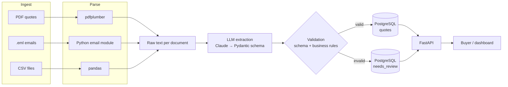
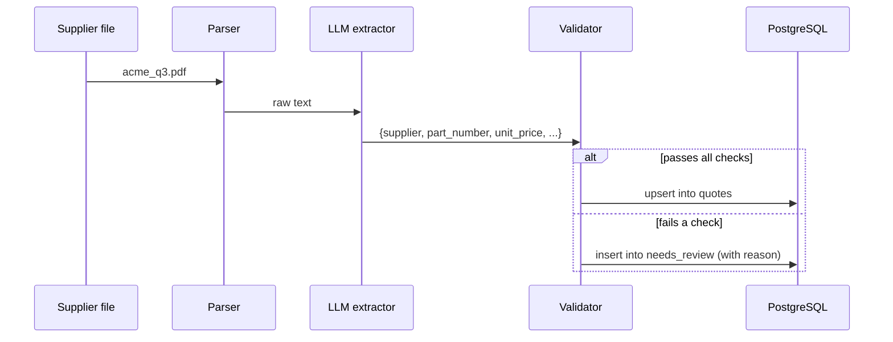

# Supplier Quote Intelligence Pipeline

Turn messy supplier quotes (PDFs, emails, spreadsheets) into clean, comparable data,
so a buyer can answer *"Who can supply part X cheapest within N days?"* in seconds
instead of digging through an inbox.

---

## The problem

Suppliers send quotes in whatever format they like:

- a PDF with a price table on page 2
- an email that says *"we can do $4.10/unit if you take 500+, ~3 weeks"*
- a CSV export with inconsistent column names and currencies

Comparing these by hand is slow and error-prone. This pipeline reads them, pulls out
the facts that matter, checks them, and stores them in one place you can query.

## What gets extracted

Every quote is reduced to the same set of fields:

| Field            | Example            | Meaning                                  |
|------------------|--------------------|------------------------------------------|
| `supplier`       | Acme Components    | Who sent the quote                       |
| `part_number`    | AX-4410            | Which part is being quoted               |
| `unit_price`     | 4.10               | Price per unit                           |
| `currency`       | USD                | Currency of the price                    |
| `moq`            | 500                | Minimum order quantity                   |
| `lead_time_days` | 21                 | Days from order to delivery              |
| `valid_until`    | 2026-12-31         | Date the quote expires                   |
| `source_file`    | acme_q3.pdf        | Original document, for traceability      |

---

## How the pipeline works



### Stage by stage

1. **Ingest:** collect documents from a folder or via `POST /ingest`.
2. **Parse:** convert each format to plain text. Nothing is interpreted yet.
3. **Extract:** an LLM (Anthropic Claude, structured output) reads the text and fills
   in the fields above. The output must match a strict Pydantic schema.
4. **Validate:** schema checks (types, required fields) plus business rules:
   - price must be greater than 0
   - lead time must be in a sane range
   - part number must be a known part

   Anything that fails goes to a **review queue** along with the reason, so it is never
   silently dropped.
5. **Load:** write to PostgreSQL. Loading is **idempotent**, so re-processing the same
   file never creates duplicate rows.
6. **Serve:** a REST API for querying, comparing and reviewing quotes.

### What happens to a single quote



---

## API (planned)

| Method | Endpoint                                 | Purpose                                        |
|--------|------------------------------------------|------------------------------------------------|
| GET    | `/quotes`                                | List all validated quotes                      |
| GET    | `/compare?part=AX-4410&max_lead_days=30` | Compare suppliers for a part, filtered by lead time |
| GET    | `/review-queue`                          | Quotes that failed validation, with reasons    |
| POST   | `/ingest`                                | Submit new documents for processing            |

---

## Measuring quality

About 20 documents are labeled by hand with the correct answers. An eval script
compares the pipeline's output with these labels and reports **accuracy per field**,
so weak spots are visible (for example, *"lead time is right 70% of the time"*).

---

## Tech stack

| Concern         | Tool                                 |
|-----------------|--------------------------------------|
| Language        | Python 3.12                          |
| Packaging       | uv                                   |
| Schema / validation | Pydantic v2                      |
| Parsing         | pdfplumber, `email` (stdlib), pandas |
| LLM             | Anthropic API (structured output)    |
| Database        | PostgreSQL                           |
| API             | FastAPI                              |
| Tests           | pytest                               |
| Deployment      | Docker Compose (app + Postgres)      |

## Project layout

```
.
├── src/quote_pipeline/   # the pipeline itself (only code that ships to production)
│   ├── config.py         #   all settings in one place (env vars / .env)
│   ├── domain/           #   models, catalog, business rules: pure logic, no I/O
│   ├── parsing.py        #   email / CSV / PDF -> text
│   ├── extraction/       #   Claude extractor + the extraction prompt
│   ├── storage/          #   Postgres repository + schema.sql
│   ├── pipeline.py       #   parse -> extract -> validate (extractor injected)
│   └── ingest.py         #   skip already-seen files, otherwise process + store
├── scripts/              # dev tools: data generator, pipeline runs (and the wiring of real objects)
├── docker-compose.yml    # local Postgres (with pgvector)
├── learning/             # crash-course exercises
├── data/generated/       # generated sample documents (gitignored)
├── tests/                # pytest suite
├── pyproject.toml        # dependencies and tool config
├── .env.example          # copy to .env and fill in secrets
└── LEARNING_LOG.md       # concepts, decisions, open questions
```

---

## Getting started

```bash
brew install uv            # once
uv sync                    # create venv and install dependencies
cp .env.example .env       # then add your ANTHROPIC_API_KEY
uv run pytest              # run tests
```